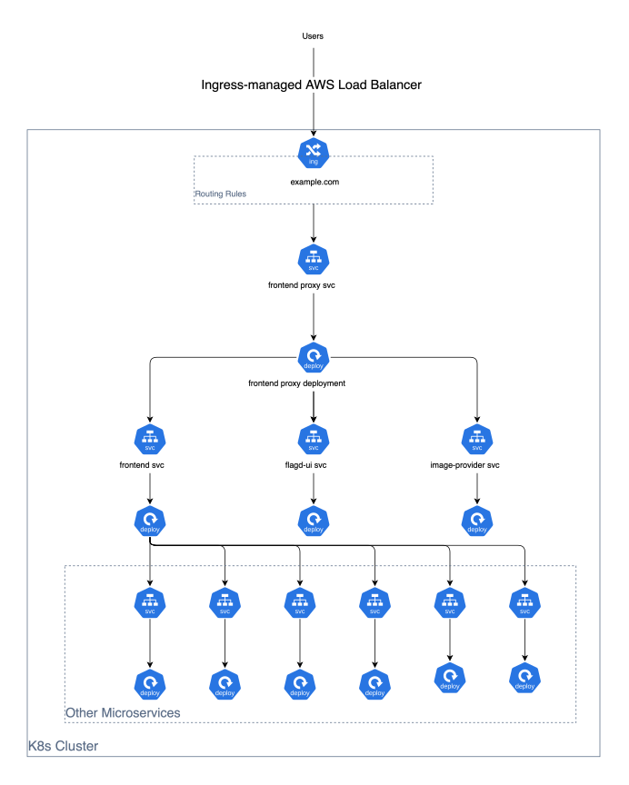

# E-Commerce DevOps Project — Kubernetes Manifests

This repository contains **kubernetes manifests** to provision **Kubernetes resources** in EKS for the **e-commerce-devops-project**.

---

### Other Related Repositories

- Iac repository for this project - [e-commerce-devops-project-iac](https://github.com/tharix46/e-commerce-devops-project-iac)
- Source code repository for this project - [e-commerce-devops-project-src](https://github.com/tharix46/e-commerce-devops-project-src)

---

### EKS Data Plane Architecture



---

### Repository Structure

```
├── accounting
│   └── deploy.yaml
├── ad
│   ├── deploy.yaml
│   └── svc.yaml
├── cart
│   ├── deploy.yaml
│   └── svc.yaml
├── checkout
│   ├── deploy.yaml
│   └── svc.yaml
├── currency
│   ├── deploy.yaml
│   └── svc.yaml
├── email
│   ├── deploy.yaml
│   └── svc.yaml
├── flagd
│   ├── cm.yaml
│   ├── deploy.yaml
│   └── svc.yaml
├── frauddetection
│   └── deploy.yaml
├── frontend
│   ├── deploy.yaml
│   └── svc.yaml
├── frontendproxy
│   ├── deploy.yaml
│   ├── ingress.yaml
│   └── svc.yaml
├── iam_policy.json
├── imageprovider
│   ├── deploy.yaml
│   └── svc.yaml
├── k8s.svg
├── kafka
│   ├── deploy.yaml
│   └── svc.yaml
├── loadgenerator
│   ├── deploy.yaml
│   └── svc.yaml
├── payment
│   ├── deploy.yaml
│   └── svc.yaml
├── productcatalog
│   ├── deploy.yaml
│   └── svc.yaml
├── quote
│   ├── deploy.yaml
│   └── svc.yaml
├── README.md
├── recommendation
│   ├── deploy.yaml
│   └── svc.yaml
├── serviceaccount.yaml
├── shipping
│   ├── deploy.yaml
│   └── svc.yaml
└── valkey
    ├── deploy.yaml
    └── svc.yaml
```

---

### Update kubeconfig and Apply Manifests

```bash
aws eks --region us-east-1 update-kubeconfig --name e-commerce-project

# check if kubeconfig is updated successfully
k config current-context
k get nodes

k apply -f serviceaccount.yaml

k apply -R -f ./
# OR
find . -type f \( -name '*.yaml' -o -name '*.yml' \) -exec kubectl apply -f {} \;
```

---

### Install AWS Load Balancer Controller

```bash
# download the IAM policy document for the AWS Load Balancer Controller
curl -O https://raw.githubusercontent.com/kubernetes-sigs/aws-load-balancer-controller/v2.11.0/docs/install/iam_policy.json

# create the IAM policy for the AWS Load Balancer Controller
aws iam create-policy \
 --policy-name AWSLoadBalancerControllerIAMPolicy \
 --policy-document file://iam_policy.json

# associate the IAM OIDC provider with EKS cluster
eksctl utils associate-iam-oidc-provider --region=us-east-1 --cluster=e-commerce-project --approve

# create an IAM service account for the AWS Load Balancer Controller
eksctl create iamserviceaccount \
 --cluster=e-commerce-project \
 --namespace=kube-system \
 --name=aws-load-balancer-controller \
 --role-name AmazonEKSLoadBalancerControllerRole \
 --attach-policy-arn=arn:aws:iam::<YOUR_ACCOUNT_ID>:policy/AWSLoadBalancerControllerIAMPolicy \
 --approve

# add and update the EKS Helm chart repository
helm repo add eks https://aws.github.io/eks-charts
helm repo update eks

# install the AWS Load Balancer Controller using Helm
helm install aws-load-balancer-controller eks/aws-load-balancer-controller -n kube-system \
 --set clusterName=e-commerce-project \
 --set serviceAccount.create=false \
 --set serviceAccount.name=aws-load-balancer-controller \
 --set region=us-east-1 \
 --set vpcId=<VPC-ID>

# check if the AWS Load Balancer Controller is running
kubectl get deployment -n kube-system aws-load-balancer-controller
```

---

### Setup /etc/hosts for ALB URL

Because there is no custom domain name for the ALB URL in this project, we need to get the ALB URL's IP address and add it to the /etc/hosts file and point it to `example.com` to access the application via the ALB URL.

`example.com` is used because ingress controller is configured to use `example.com` as the host in the ingress resource.

```bash
nslookup <alb url>
sudo vim /etc/hosts
# add alb ip address and example.com to the file
```

---

### Install and Configure ArgoCD

```bash
k create namespace argocd

k apply -n argocd --server-side --force-conflicts -f https://raw.githubusercontent.com/argoproj/argo-cd/stable/manifests/install.yaml

k get pods -n argocd

# expose the ArgoCD server as a LoadBalancer service
k edit svc argocd-server -n argocd
# make it type LoadBalancer

k get svc -n argocd

# get the initial admin password for ArgoCD
k get secret argocd-initial-admin-secret -n argocd -o jsonpath="{.data.password}" | base64 -d; echo
```

---

### Uninstall AWS Load Balancer Controller

```bash
helm uninstall aws-load-balancer-controller -n kube-system

eksctl delete iamserviceaccount \
 --cluster=e-commerce-project \
 --namespace=kube-system \
 --name=aws-load-balancer-controller

aws iam delete-policy \
 --policy-arn arn:aws:iam::<YOUR_ACCOUNT_ID>:policy/AWSLoadBalancerControllerIAMPolicy

```

---
